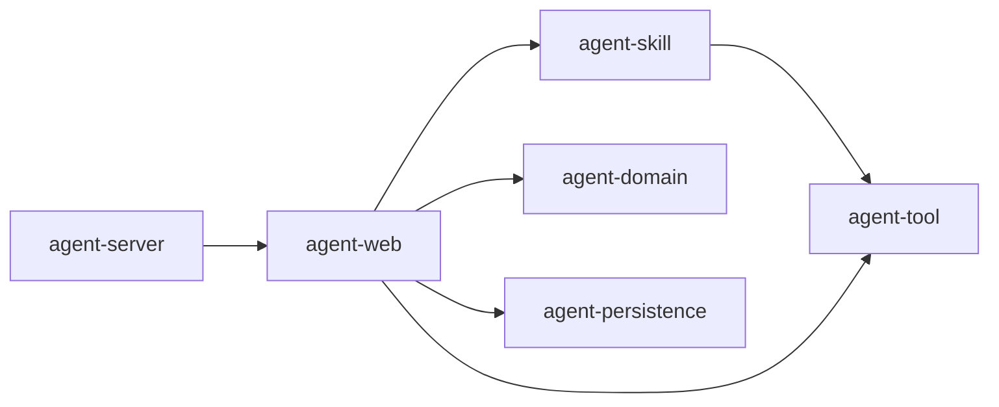

# 联网搜索与 Tool/Skill 独立模块设计

> 状态：设计已批准，实施计划已编写
> 适用仓库：Data Agent V2
> 设计日期：2026-08-30
> 外部契约依据：[Tavily Search API](https://docs.tavily.com/documentation/api-reference/endpoint/search)

## 1. 背景与结论

当前 `agent-web` 同时承载 ReAct 应用编排、Tool SPI、Tool 注册表和三个内置 Tool；Skill 只有设计草案，没有运行时代码。该边界使具体能力与 HTTP/BFF 模块耦合，也无法表达“Skill 读取后才开放依赖 Tool”的渐进披露语义。

本次新增两个 Maven Module：

- `agent-tool`：承载 Tool 稳定契约、Tool 供给与 execution 级可见视图、内置 Tool，以及 Tavily 联网搜索实现；
- `agent-skill`：承载只读 bundled Skill、严格资源读取、`skill_read` 和受限 Tool 激活。

首版联网搜索只接入 Tavily，但保留最小 Provider SPI。`web_search` 默认不向模型暴露；模型读取内置 `web-research` Skill 后，系统才在本次 execution 的上限内原子激活该 Tool。

首版配置仅来自环境变量或 `application.yml`。不增加数据库配置、配置管理 API、能力快照表或 Skill 激活表。当前运行中的 execution 不支持跨进程恢复，因此能力快照和激活状态保存在 execution 生命周期内的 JVM 内存中。

## 2. 目标与非目标

### 2.1 目标

1. 将具体 Tool 和 Skill 从 `agent-web` 分离到不同 Java Module。
2. 将现有 `system_timezone`、`current_time`、`web_search` 迁入 `agent-tool`。
3. 把现有 Wikipedia 验证工具替换为正式的 Tavily 全网搜索。
4. 为每次 execution 冻结 `maximum` 和初始 `visible` Tool 集合。
5. 实现 classpath bundled Skill 的发现、严格解析、摘要注入、资源读取与受限激活。
6. 保留现有 ReAct、Tool timeout、取消、ProcessItem 状态流转、结果脱敏和持久化行为。
7. 以自动化测试证明未激活 Tool 不可执行、Skill 不能越权扩大能力边界。

### 2.2 非目标

- 不接入博查、阿里云 IQS、豆包或腾讯搜索；
- 不实现多 Provider 并发、故障自动切换、重试、熔断或费用预算；
- 不实现网页全文抓取；
- 不实现用户、租户或项目级数据库分层配置；
- 不实现 Tool/Skill 管理 API 或管理页面；
- 不实现 Skill 上传、在线编辑、嵌套 Skill、脚本执行或自动导入；
- 不实现能力快照和 Skill 激活的跨进程恢复；
- 不在本次建设 Evidence Ledger 或前端引用卡片；
- 不提前抽取 `agent-capability-spi`，也不建设 MCP Module。

## 3. 模块与依赖边界

下图中箭头表示“调用方依赖被调用方”：



### 3.1 `agent-tool`

职责：

- `AgentTool`、调用上下文和 Tool 安全业务异常；
- 全局 Tool 供给注册表和重名校验；
- execution 级 `maximum`、`visible`、冻结绑定和原子批量激活；
- `system_timezone`、`current_time`、`web_search`；
- `WebSearchProvider`、统一查询/结果模型、Tavily Adapter；
- 固定目标地址、代理感知的 HTTP Transport；
- `data-agent.tool.*` 服务端配置。

该模块不得依赖 `agent-web`、Mapper 或 MyBatis API。Tool singleton 必须线程安全，单次调用状态只存在于参数、调用上下文或局部变量中。

### 3.2 `agent-skill`

职责：

- `SkillDescriptor`、`SkillResource` 和内容 digest；
- 扫描固定 classpath 根目录 `skills/`；
- 严格解析 `SKILL.md` frontmatter；
- 读取当前 Skill 包内受限 UTF-8 文本资源；
- `skill_read` Tool；
- 对 `agent-tool` 的 execution 视图执行 all-or-none 激活；
- 提供内置 `web-research` Skill。

`agent-skill` 依赖 `agent-tool`，但 `agent-tool` 不感知 Skill。Skill 不能注册任意实现、修改 `maximum` 或直接执行脚本。

### 3.3 `agent-web`

保留：

- `ToolExecutionCoordinator`；
- Tool ProcessItem 的开始、完成和失败持久化；
- `ToolFailureSanitizer` 及运行时异常到 observation 的映射；
- ReAct 应用编排；
- execution 启动和终态清理。

移除：

- `AgentTool` 和全局 Tool 注册表的实现；
- `conversation.tool.builtin` 下的三个具体 Tool。

`agent-web` 每轮只从 execution 级 Tool 视图读取模型定义和执行绑定，不再把全局注册表中的全部 Tool 直接暴露给模型。

### 3.4 `agent-server`

继续作为唯一可执行 Module，通过现有组件扫描和配置属性扫描完成装配。它依赖 `agent-web`，并通过传递依赖获得 `agent-tool` 和 `agent-skill`，不承载业务 Tool 或 Skill 实现。

## 4. Tool 能力视图

每次 execution 至少包含两个集合：

```text
visible ⊆ maximum ⊆ registeredSupply
```

- `registeredSupply`：当前进程成功注册的 Tool；
- `maximum`：execution 创建时由服务端策略解析出的不可突破上限；
- `visible`：当前模型调用可见且可执行的集合。

默认配置：

```yaml
data-agent:
  tool:
    maximum:
      - system_timezone
      - current_time
      - skill_read
      - web_search
    initial:
      - system_timezone
      - current_time
      - skill_read
```

启动时必须校验：

- `initial` 是 `maximum` 的子集；
- 配置中的每个精确 Tool 名称均已注册；
- Tool 名称不存在重复绑定；
- `skill_read` 位于 `initial`；
- Skill 声明的每个依赖 Tool 已注册。

execution 启动前，`ExecutionToolViewFactory` 复制当前策略和绑定，形成不可变 `maximum` 与可变但单调扩张的 `visible`。激活操作先验证全部名称和冻结绑定，再用同一临界区一次性更新；任何依赖失败都不得留下部分结果。

模型臆造调用隐藏 Tool 时，execution resolver 返回 `tool_not_visible`，不得退回全局注册表执行。全局注册仅代表实现存在，不代表当前 execution 获得权限。

execution 成功、失败、取消或超时后，启动器必须在 `finally` 中删除内存能力视图。进程退出时未完成 execution 仍按当前规则在下次启动时收敛为失败，不恢复内存激活状态。

## 5. Bundled Skill 与渐进披露

首版资源布局：

```text
agent-skill/src/main/resources/skills/
└── web-research/
    └── SKILL.md
```

frontmatter：

```yaml
---
name: web-research
description: 当问题需要最新信息或外部公开资料时使用。
required_tools:
  - web_search
---
```

仅支持 `name`、`description`、`required_tools`。未知字段、重复名称、空描述、重复依赖、未知依赖、无效 UTF-8、超出大小限制或资源路径非法均使应用启动失败。资源读取只接受规范化相对路径，拒绝绝对路径、`..`、反斜杠旁路、目录目标和 Skill 根目录之外的资源。

`skill_read` 的模型契约：

```json
{
  "logical_id": "web-research",
  "path": "SKILL.md"
}
```

`path` 可省略，默认 `SKILL.md`。读取 `SKILL.md` 时执行以下顺序：

1. 确认 `logical_id` 存在于本次 execution 冻结的 Skill 摘要；
2. 校验当前资源 digest 与冻结 digest 一致；
3. 验证所有 `required_tools` 已注册、位于 `maximum` 且绑定未变化；
4. 原子加入 `visible`；
5. 返回正文、digest、激活 Tool 名称和是否为重复激活。

重复读取是幂等操作。读取 Skill 其他允许资源不产生额外激活。`skill_read` 必须由初始策略授予，Skill 不得通过把它写入 `required_tools` 来自举。

Context Factory 为每轮调用创建一条固定 system message，其中只包含 Skill 的名称、摘要以及调用 `skill_read` 的方法，不直接注入 `SKILL.md` 正文。`raw`、`lsm`、`hierarchical` 三种上下文策略都必须保留该固定消息；当前 `raw` 策略未拼接 `fixedSystemMessages`，实施时需修正并增加回归测试。

`web-research` 正文至少说明：

- 在问题依赖近期事实或外部公开资料时使用；
- 不把密钥、访问令牌、客户机密或未脱敏个人信息放入查询；
- 搜索摘要不等于网页全文；
- 回答需要携带结果中的 URL 来源；
- 搜索无结果或失败时不得编造来源。

## 6. `web_search` 契约

### 6.1 模型输入

```json
{
  "query": "2026 年 Java Agent 工具调用最新实践",
  "limit": 5,
  "search_depth": "basic"
}
```

| 字段 | 必填 | 约束 | 缺省行为 |
| --- | --- | --- | --- |
| `query` | 是 | trim 后 1～400 字符 | 无 |
| `limit` | 否 | 整数 1～20 | 使用 `default-limit` |
| `search_depth` | 否 | `basic` 或 `advanced` | 使用 `default-depth` |

首版不接受数量别名，不允许非法 depth 静默降级。Tool 调用参数优先于服务端默认值，但不能覆盖 API Key、代理、Endpoint 或 timeout。

### 6.2 服务端配置

```yaml
data-agent:
  tool:
    web-search:
      provider: tavily
      api-key: ${DATA_AGENT_TAVILY_API_KEY:}
      default-limit: ${DATA_AGENT_WEB_SEARCH_DEFAULT_LIMIT:5}
      default-depth: ${DATA_AGENT_WEB_SEARCH_DEFAULT_DEPTH:basic}
      connect-timeout: ${DATA_AGENT_WEB_SEARCH_CONNECT_TIMEOUT:5s}
      request-timeout: ${DATA_AGENT_WEB_SEARCH_REQUEST_TIMEOUT:20s}
      tool-timeout: ${DATA_AGENT_WEB_SEARCH_TOOL_TIMEOUT:25s}
      proxy: ${DATA_AGENT_WEB_SEARCH_PROXY:}
```

允许应用在 API Key 为空时启动，以便不使用联网搜索的环境继续运行；实际调用返回 `web_search_not_configured`。`provider` 首版只允许 `tavily`，保留该字段是为了让 Provider 路由成为明确边界，而不是让模型选择供应商。

三个 timeout 均须为正，并满足 `connect-timeout <= request-timeout < tool-timeout`。这样 HTTP 层先产生可分类的请求超时，外层 Tool 协调器只负责兜底，避免两个相同截止时间竞争而产生不稳定错误码。

### 6.3 Provider SPI

```java
interface WebSearchProvider {
    String id();

    List<WebSearchResult> search(WebSearchQuery query) throws WebSearchException;
}
```

统一模型只暴露供应商无关字段：

```java
record WebSearchQuery(String query, int limit, SearchDepth depth) {}

record WebSearchResult(
        String title,
        String url,
        String snippet,
        Double score) {}
```

API Key、代理和 timeout 属于 Provider/Transport 的服务端配置，不进入 `WebSearchQuery`，从而避免凭据被普通 DTO 序列化或日志输出。

### 6.4 Tavily 请求

固定请求：

```http
POST https://api.tavily.com/search
Authorization: Bearer <api-key>
Content-Type: application/json
```

```json
{
  "query": "...",
  "max_results": 5,
  "search_depth": "basic",
  "include_answer": false,
  "include_raw_content": false,
  "include_images": false
}
```

不请求 Tavily 生成答案、网页全文或图片。Provider 从 `results[]` 读取 `title`、`url`、`content`、`score`，把 `content` 归一化为 `snippet`。结果最终再次按有效 `limit` 截断，防止上游超量返回。

### 6.5 Tool 输出

```json
{
  "query": "...",
  "provider": "tavily",
  "results": [
    {
      "index": 1,
      "title": "Example",
      "url": "https://example.com/article",
      "snippet": "归一化并截断后的摘要",
      "score": 0.91
    }
  ],
  "references": [
    {
      "index": 1,
      "title": "Example",
      "url": "https://example.com/article"
    }
  ]
}
```

`results` 与 `references` 的编号必须严格一致。每条摘要归一化空白并限制为 500 个 Unicode code point，超出后追加省略号。只保留合法的绝对 `http`/`https` URL；无效 URL 或其他 scheme 的单条结果被丢弃。明确存在且为空的 `results` 是成功；关键数组缺失是协议漂移错误。

`score` 表示 Tavily 返回的相关性分数；上游省略该字段时输出 JSON `null`，不得自行估算。标题或摘要缺失时使用空字符串，但 URL 缺失或非法时丢弃整条结果。

当前系统使用结构化 JSON observation，因此不复制 Nova 的 `<<<REFERENCES>>>` 文本协议。后续 Evidence Ledger 或前端引用卡片可直接读取稳定的 `references` 数组。

## 7. HTTP、取消与代理

生产 Transport 使用 JDK `HttpClient`：

- 连接超时默认 5 秒；
- 单次请求超时默认 20 秒，同时仍受 Tool timeout 和 execution deadline 约束；
- 禁止自动重定向；
- 默认使用 `NO_PROXY`，不继承系统代理；
- 显式代理只接受 `http(s)://host:port`；非法配置使应用启动失败；
- 不自动重试，避免重复收费；
- Endpoint 固定，不接受运行时自定义 URL。

同步 Tool 接口内部可使用 JDK HTTP 调用。线程被协调器取消时必须恢复中断语义并终止等待，不能吞掉 `InterruptedException`。即使底层网络栈不能立即撤销已发出的远端工作，本地也不得继续解析和持久化成功结果。

为可测试性引入窄接口 `WebSearchTransport`，只负责发送规范化 HTTP 请求并返回状态、Headers 和 Body。Provider 负责供应商字段映射和业务解析，Transport 不理解 Tavily JSON。

## 8. 错误语义

| 场景 | 稳定结果码 | 说明 |
| --- | --- | --- |
| 参数非法 | `invalid_arguments` | 网络调用前失败 |
| Tool 不可见 | `tool_not_visible` | 不从全局注册表降级执行 |
| API Key 缺失 | `web_search_not_configured` | 应用仍可启动 |
| HTTP 401/403 | `web_search_authentication_failed` | 不返回上游正文 |
| HTTP 429 | `web_search_rate_limited` | 不自动重试 |
| HTTP 5xx、连接失败 | `web_search_unavailable` | 返回安全业务错误 |
| 请求超时 | `tool_timeout` | 复用现有协调器语义 |
| 非法 JSON、关键字段缺失 | `web_search_invalid_response` | 不伪装为空结果 |
| Skill 不存在 | `skill_not_found` | 不读取资源 |
| Skill 路径越界 | `skill_resource_denied` | 拒绝路径穿越 |
| Skill 依赖越界或绑定失效 | `skill_activation_denied` | 不部分激活 |

Tool 的安全业务异常迁入 `agent-tool`，`agent-web` 的 `ToolFailureSanitizer` 负责映射为现有 `ToolExecutionResult`。未知异常继续返回统一 `tool_error`，不得把堆栈、配置或供应商正文交给模型。

## 9. 安全与隐私

1. API Key 不进入模型参数 Schema、Tool 输出、异常消息、对象字符串或普通日志。
2. 固定 HTTPS Endpoint 和禁止重定向共同限制 SSRF 与目标漂移。
3. 代理是受信任基础设施；配置错误必须 fail-fast，不允许静默直连。
4. 搜索词会发送到 Tavily。Skill 必须提醒模型避免提交密钥、令牌、客户机密和未脱敏个人信息。
5. 上游非成功响应正文不返回模型；日志只记录 HTTP 状态、耗时、结果数和可用的 `request_id`。
6. 结果 URL 视为不可信外部数据，只作为文本和引用返回，不由服务端自动访问。
7. Skill 资源只读，不允许执行 `scripts/`、`bin/` 或资源正文中的命令。

## 10. 可观察性

首版记录不含查询正文和凭据的结构化日志或指标：

- provider；
- search depth；
- 请求耗时；
- HTTP 状态族；
- 结果数；
- 成功或稳定错误码；
- Tavily `request_id`（存在时）；
- Skill logical ID、digest、激活结果和激活 Tool 名称。

不记录 API Key、Authorization Header、完整请求体或上游错误正文。

## 11. 测试设计

所有生产行为按 TDD 实施，先运行目标测试确认因缺少能力而失败，再写最小实现使其通过。

### 11.1 `agent-tool`

- 注册表拒绝重复 Tool 名称；
- `initial` 必须是 `maximum` 子集，策略中的名称必须已注册；
- execution 视图只解析 `visible` Tool；
- 原子批量激活成功、越界时零部分写入；
- query、limit、depth 参数边界和调用值覆盖默认配置；
- 缺少 API Key 时不调用 Transport；
- Tavily 请求方法、固定 URL、Bearer Header 和 JSON 字段正确；
- Tavily 成功响应归一化，最终结果不超过 limit；
- 空结果成功，关键数组缺失、非法 JSON 和 HTTP 错误失败；
- 非 HTTP(S) URL 被过滤，摘要按 code point 安全截断；
- API Key 不出现在异常、日志对象和输出中；
- Transport 的无代理、显式代理、禁止跳转和 timeout 配置正确。

### 11.2 `agent-skill`

- frontmatter 严格解析；
- 重复 Skill、未知字段、未知 Tool、重复依赖启动失败；
- 非法 UTF-8、绝对路径、`..` 和跨 Skill 读取被拒绝；
- `skill_read` 返回正文和 digest；
- 首次读取 `SKILL.md` 原子激活依赖；
- 重复读取幂等；
- 任一依赖不在 `maximum` 时全部不激活；
- `web-research` 的声明、摘要和实际资源一致。

### 11.3 `agent-web` 与 `agent-server`

- 第一轮只提供 `system_timezone`、`current_time`、`skill_read`；
- 读取 Skill 后下一轮增加 `web_search`；
- 未激活时臆造调用 `web_search` 返回 `tool_not_visible` 且 Transport 零调用；
- Tool 成功、失败和超时仍按现有 ProcessItem 状态持久化；
- `raw`、`lsm`、`hierarchical` 均保留 Skill 摘要 system message；
- execution 正常、异常、取消和超时均清理内存能力视图；
- Spring 上下文能发现两个新 Module 中的组件和配置属性；
- 现有 ReAct、契约和上下文策略测试无回归。

### 11.4 验证命令

```powershell
.\backend\mvnw.cmd -f .\backend\pom.xml -B -pl agent-tool test
.\backend\mvnw.cmd -f .\backend\pom.xml -B -pl agent-skill -am test
.\backend\mvnw.cmd -f .\backend\pom.xml -B -pl agent-web -am test
.\backend\mvnw.cmd -f .\backend\pom.xml -B -pl agent-server -am test
.\backend\mvnw.cmd -f .\backend\pom.xml -B verify
```

测试不得调用真实 Tavily。Provider 单元测试使用 Fake Transport，HTTP 组装测试使用本地 Stub Server。

## 12. 验收标准

1. Maven reactor 包含独立 `agent-tool` 和 `agent-skill`，两者均不依赖 `agent-web`。
2. `agent-web` 不再包含具体 built-in Tool，也不再直接把全局注册表全部暴露给模型。
3. 无 Tavily Key 时应用正常启动，实际搜索返回稳定配置错误且不泄密。
4. 第一轮模型看不到 `web_search`；成功读取 `web-research` 后下一轮可见。
5. Skill 依赖不在 `maximum` 时激活完全失败，`visible` 不发生部分变化。
6. Tavily 成功结果按统一 JSON 输出，结果与引用编号一致且数量不超过 limit。
7. 空结果、供应商失败和协议漂移具有不同可观察语义。
8. execution 任意终态后不残留能力视图。
9. 三种上下文策略都保留 Skill 摘要和已有 Tool 协议顺序。
10. 新模块定向测试、`agent-server -am` 测试和全 reactor `verify` 均通过。

## 13. 后续演进边界

当出现第二个或更多 Provider 时，在 `agent-tool` 内增加 Adapter，不改变模型 Tool 契约。只有在 MCP 或其他独立能力来源实际进入实现后，才从稳定边界提取 `agent-capability-spi`。

认证、租户和项目权限完成重新设计后，可把服务端配置 resolver 替换为数据库分层配置实现，并把 execution 快照与 Skill 激活持久化到 `agent-persistence`。这些演进必须继续保持：Skill 依赖不能扩大 `maximum`、凭据不进入模型上下文、设置变更只影响新 execution。
