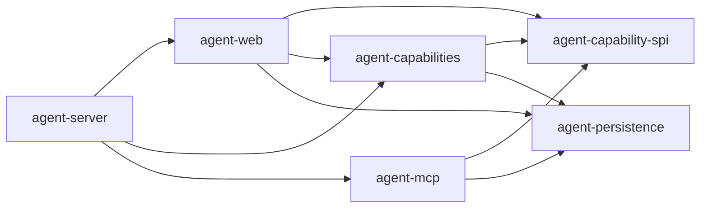

# Tool、Skill 与 MCP 能力治理设计方案

> 状态：设计草案，暂不实施
> 适用仓库：Data Agent V2
> 参考材料：[Nova Agent 平台复刻文档目录](https://alidocs.dingtalk.com/i/nodes/b9Y4gmKWrPOMgz09s4yzG9veJGXn6lpz)

## 1. 结论

Data Agent V2 不应把 Tool、Skill、MCP 分别做成三套互不关联的功能，而应建立一条统一的“能力供给—治理—运行—审计”链路：

```text
Tool / Skill / MCP 资源存在
        ↓
可发现的能力供给
        ↓
本次执行的最大能力边界 maximum
        ↓
首轮暴露给模型的 initial
        ↓
Skill 读取后的受限激活
        ↓
按冻结绑定执行、持久化和审计
```

本方案建议：

1. 保留当前 ReAct、工具执行短事务、lease fencing、幂等键、结构化失败和敏感信息脱敏能力。
2. 把当前“所有 Spring `AgentTool` 自动暴露给每次模型调用”的行为，改成“每个 Agent execution 冻结一份能力快照”。
3. Tool 使用稳定运行时名称和执行源 fingerprint；模型声明、运行查找、策略过滤和审计使用同一个名称。
4. Skill 采用渐进披露：首轮仅注入摘要，模型选择后读取完整 `SKILL.md`，再在本次 maximum 内原子激活依赖工具。
5. MCP 只作为动态 Tool 供给源；连接成功不等于 Agent 获得调用权限。
6. 当前阶段继续使用固定 `TenantContext`、`OperatorContext`，不设计登录、RBAC 或租户切换。能力解析接口保留身份输入，但不扩张当前认证范围。
7. 第一阶段只支持静态 Tool 和只读 bundled Skill；上传 Skill、持久化管理面和 MCP 放在后续阶段。

## 2. 参考设计中值得吸收的优点

### 2.1 不把多个状态压成一个 `enabled`

Tool 至少存在以下不同状态：

| 状态 | 回答的问题 |
| --- | --- |
| registered | 当前进程是否存在可执行实现 |
| catalogued | 是否进入可查询、可审计的能力目录 |
| maximumAllowed | 是否进入本次执行不可突破的上限 |
| initialVisible | 是否在当前模型调用中可见 |
| skillActivatable | 是否可以被已读取 Skill 激活 |
| executableNow | 当前执行能否按名称和 fingerprint 找到冻结实现 |

这些状态必须分别计算。配置存在、Skill 声明依赖、MCP 已连接或项目挂载资源，都不能直接得到 `executableNow=true`。

### 2.2 运行时名称与能力 ID 分离

- `runtimeName` 是模型 tool call、执行查找、策略和事件的权威键。
- `capabilityId` 是目录、配置和持久化关联键。
- `bindingFingerprint` 标识执行来源，不含密钥，用于阻止同名工具在运行中换绑。

这能避免“模型调用名称、数据库能力 ID、MCP 原始工具名”混用造成的权限和恢复问题。

### 2.3 每次运行冻结策略

设置变更只影响新 execution。已开始 execution 的 maximum、initial、工具绑定、Skill 摘要版本和策略 hash 保持不变；执行恢复或 lease 接管继续消费同一快照。

这与当前上下文策略在 execution 首次进入时冻结的设计一致，也便于故障复现。

### 2.4 Skill 渐进披露

所有 Skill 全文不应永久进入 system prompt。首轮只提供有限摘要；完整指令在模型明确选择后读取。这样可以：

- 降低 Token 占用；
- 减少互相冲突的行为说明；
- 让 Skill 使用产生明确的工具事件和审计证据；
- 只在实际需要时开放依赖工具。

### 2.5 管理面与运行面分离

目录、配置和 UI 保存成功，只说明 desired state 已持久化；真正执行还要经过注册、策略快照、来源健康和 fingerprint 校验。管理 API 必须能解释“为什么不可用”，不能只返回一个开关。

### 2.6 用结构化证据区分事实和期望

参考目录使用 `I/A/K/P/R/F/D` 区分静态实现、验收契约、已知缺陷、规划、运行验证、推断和建议。Data Agent 的设计和验收也应保留类似口径：

- 代码存在不等于运行通过；
- inventory 存在不等于当前运行时已经实现；
- 已知缺陷不能被当成兼容行为复制；
- 推荐设计必须通过测试变成仓库事实。

## 3. Data Agent 当前基础与主要缺口

### 3.1 已有优势

当前实现已经具备一条可靠的工具执行骨架：

- `AgentTool` 提供稳定名称、描述、JSON Schema、timeout、幂等能力和服务端调用上下文；
- `AgentToolRegistry` 在启动时拒绝重复名称，并保持确定性顺序；
- `ReactExecutionEngine` 在模型调用和工具结果边界之间显式循环；
- 工具调用先归档再执行，支持恢复；
- `ToolExecutionTransactionService` 在工具调用前后使用独立短事务，不在外部 I/O 期间持有数据库事务；
- 工具状态迁移受 execution owner、attempt 和 version fencing 保护；
- 幂等工具使用稳定幂等键；
- 超时、业务异常和未知异常被转换为结构化且脱敏的 Observation；
- 同一 model invocation 内按归档顺序执行，单个工具失败不会吞掉后续结果。

这些能力应原样保留并成为新能力运行时的执行层。

### 3.2 当前缺口

1. `AgentToolRegistry.modelDefinitions()` 每轮返回全部注册工具，没有 per-run 策略。
2. 模型看到的 Tool 集合与执行阶段查找的集合都来自全局注册表，无法表达 initial、maximum 和 Skill 激活。
3. execution 未保存工具策略版本、绑定 fingerprint 或 Skill 激活状态。
4. JSON Schema 只提供给模型，执行前没有统一结构校验。
5. Tool 定义尚未表达 risk、interactionMode、result retention、稳定结果码和配置 Schema。
6. `contracts/inventories/tools.yaml`、`skills.yaml` 已分别冻结 56 个 Tool、8 个 Skill，但当前只承担文档库存，未与运行时代码做双向一致性校验。
7. inventory 指向的 `agent-capabilities` 模块和 Skill 资源当前并不存在。
8. 没有 Skill registry、摘要注入、`skill://`/专用读取协议、资源边界或激活器。
9. 没有动态 Tool provider，因此尚无 MCP 的连接状态、命名、同步和来源漂移处理。

## 4. 目标与非目标

### 4.1 本次能力建设目标

- 建立稳定 Tool/Skill SPI 和统一运行时名称。
- 建立全局供给注册表与 per-execution 冻结视图。
- 支持 Tool Group、main Agent policy、maximum/initial 计算和解释。
- 支持 bundled Skill 的安全扫描、摘要发现、正文/资源读取和受限激活。
- 让 execution 恢复、重试和 lease 接管继续使用原快照及激活状态。
- 为后续管理 UI、上传 Skill 和 MCP 留出稳定边界。
- 用契约测试保证 inventory、代码、Skill 包和工具组互相引用一致。

### 4.2 当前明确不做

- 不实现登录、租户切换、RBAC 或完整多租户管理页面。
- 不允许 Skill 包自动执行 `scripts/` 或 `bin/`。
- 不在第一阶段提供 Skill 上传、在线编辑、市场或同名多作用域覆盖。
- 不在第一版 MCP 中支持 stdio 任意命令。
- 不把 capability inventory 直接当作运行时执行代码。
- 不引入“缺少 policy 时暴露全部工具”的兼容回退。

## 5. 推荐模块边界

在现有 Maven reactor 中增加三个模块，职责如下：

### 5.1 `agent-capability-spi`

纯 Java 稳定契约，不依赖 Spring、MyBatis 或 `agent-web`：

- ToolDefinition、Tool、ToolResult、ToolExecutionContext；
- ToolRisk、InteractionMode、ResultRetention；
- ToolBinding、binding fingerprint；
- SkillBundle、SkillDescriptor、SkillResource、SkillResourceLoader；
- ToolSupplyProvider、CapabilitySnapshot 等跨模块接口。

现有 `AgentTool` 应迁移为该模块中的稳定 SPI，保留原有 timeout、幂等和调用上下文语义。

### 5.2 `agent-capabilities`

统一能力运行时和 bundled 能力实现：

- Tool supply registry 与冲突检测；
- Tool Group 解析、策略 resolver、snapshot builder；
- execution-scoped Tool view；
- bundled Tool 实现；
- bundled Skill 扫描、严格解析、摘要目录、资源读取和激活；
- inventory lint、catalog projection、策略解释；
- 对 `agent-web` 提供应用级 port，不提供 HTTP Controller。

当前三个 built-in Tool 从 `agent-web` 迁入本模块。

### 5.3 `agent-mcp`

后续阶段的动态 Tool provider：

- MCP Server desired state；
- streamable HTTP transport、握手和 `tools/list`；
- 连接快照、健康、重连和 CAS 切换；
- MCP Tool adapter、命名和 fingerprint；
- 密钥封存、SSRF 防护和审计。

第一阶段可以只保留接口和测试 Stub，不加入生产依赖。

### 5.4 现有模块职责保持不变

- `agent-persistence`：新增所有 Entity、Mapper、`ServiceImpl`、迁移和 repository-style 查询；其他模块不得引用 Mapper 或 MyBatis API。
- `agent-web`：REST/SSE、BFF、会话应用逻辑、ReAct 编排和接口契约测试；通过 capability port 获取 execution-scoped 视图。
- `agent-server`：唯一可执行模块，只做启动、全局异常边界和运行时装配。
- `agent-evals`：继续只通过公开 HTTP 契约验证，不依赖运行时模块。

推荐依赖方向：



## 6. 核心领域契约

### 6.1 Tool 定义

建议的稳定定义字段：

```java
record ToolDefinition(
    String runtimeName,
    String description,
    JsonNode parametersSchema,
    List<ToolConfigField> configSchema,
    ToolRisk risk,
    InteractionMode interactionMode,
    boolean idempotent,
    Duration timeout,
    ResultRetention defaultRetention,
    Set<String> stableResultCodes,
    String category
) {}
```

规则：

- `parametersSchema` 只描述模型本次调用参数；
- `configSchema` 只描述服务端配置和密钥，绝不发送给模型；
- `runtimeName` 全局唯一、大小写敏感，创建后不可变；
- Tool singleton 必须线程安全，请求态只存在于参数或执行上下文；
- runtime name、description、Schema 和 source fingerprint 参与 definition digest；
- inventory 中的 `allowedSkills` 只作为追溯关系，不作为授权来源。

### 6.2 Tool 绑定

```java
record ToolBinding(
    String runtimeName,
    String capabilityId,
    String sourceType,
    String sourceId,
    String bindingFingerprint,
    String definitionDigest,
    Tool tool
) {}
```

静态 Tool 的 fingerprint 可由实现类型、版本和 definition digest 生成；MCP Tool 使用 server ID、server revision、原始工具名和 Schema digest 生成。fingerprint 不包含 endpoint 密钥、Header 或环境变量。

### 6.3 Tool 结果

```java
record ToolResult(
    Status status,
    JsonNode content,
    String resultCode,
    String message,
    ResultRetention retention,
    List<ArtifactRef> artifacts
) {}
```

保留等级：

- `EPHEMERAL`：仅当前推理阶段需要，可在压缩后删除正文；
- `CONDENSABLE`：可被上下文策略摘要；
- `DURABLE`：必须保留稳定引用或转存 Artifact，不允许只剩模型摘要。

当前 `ToolExecutionResult` 可以作为迁移起点，先补充 retention 和结构化 result code，Artifact 留到后续阶段。

### 6.4 Skill 定义

```yaml
---
name: metric-platform-analysis
description: 当用户需要指标分析、维度查询或语义解释时使用。
trigger: auto
required_tools:
  - metric_query_validate
  - metric_query_execute
auto_import: false
---
```

第一阶段支持：

- `SKILL.md`；
- `references/`、`assets/`、`templates/` 下的 UTF-8 文本资源；
- `name`、`description`、`trigger`、`required_tools`、`auto_import=false`；
- classpath bundled 来源。

第一阶段不支持：

- 自动执行 scripts/bin；
- 嵌套 Skill；
- `required_skills`；
- 上传 ZIP；
- `auto_import=true`。

先把最小边界做严格，再按验收需要扩张。

## 7. 运行时策略模型

### 7.1 两个集合

每次 execution 至少冻结两个集合：

```text
maximum = 本次 execution 任何时刻都不可突破的工具集合
initial = 首次模型调用直接看到的工具集合

始终满足：initial ⊆ maximum ⊆ registeredSupply
```

第一阶段的来源：

- `registeredSupply`：当前进程注册的静态 Tool；
- `maximum`：main Agent 绑定的系统 Tool Group，减去显式 disabled/excluded；
- `initial`：组内标记为默认的工具，加上专用 `skill_read`；
- Skill 只能把 `required_tools ∩ maximum` 加入当前可见集合。

若 main policy 缺失、包含未知精确工具、引用循环或同名多来源，execution 创建失败；绝不回退到全部工具。

### 7.2 Tool Group

第一阶段 Tool Group 只支持：

- 精确 runtime name；
- `@group-name` 嵌套引用；
- 保序去重；
- 完整循环检测和引用路径错误。

第一阶段不支持 glob。未来若为 MCP 增加 glob，只在新 execution 创建时对当时的 supply snapshot 展开，并把最终名称和 fingerprint 写入快照。

### 7.3 execution 冻结快照

```java
record RunCapabilitySnapshot(
    String executionId,
    long registryRevision,
    long policyRevision,
    String policyHash,
    List<FrozenToolBinding> maximumTools,
    Set<String> initialToolNames,
    List<SkillSummarySnapshot> visibleSkills,
    Map<String, String> exclusionReasons,
    Instant frozenAt
) {}
```

模型调用和执行器必须使用同一个 execution-scoped view：

- ReAct 每一轮从 view 获取当前 `modelDefinitions()`；
- Tool dispatch 按 execution ID、runtime name 和冻结 fingerprint 查找；
- 当前 supply 中同名 binding 的 fingerprint 与快照不一致时 fail-closed；
- 设置或 registry 变化只影响新 execution；
- lease 接管从数据库重建 snapshot 和 Skill activation，不重新解析当前策略。

### 7.4 Skill 激活

建议提供专用只读 Tool：

```text
skill_read(logicalId, path = "SKILL.md")
```

不直接复用任意文件读取工具，避免 Skill 发现能力顺带扩大文件系统权限。

激活流程：

1. 首轮模型收到有限 Skill 摘要和 `skill_read`。
2. 模型读取 `SKILL.md`。
3. 服务端验证该 logical ID 存在于本 execution 冻结的 Skill 目录中。
4. 校验 Skill digest 与快照一致。
5. 读取 `required_tools`。
6. 所有依赖必须已注册、位于 maximum、未被排除且 fingerprint 匹配。
7. Data Agent 默认采用 all-or-none：任一依赖不可用，本批不激活任何工具，返回结构化诊断。
8. 成功后持久化 activation，再把依赖加入当前 visible set。
9. 下一轮模型调用看到扩展后的 Tool Schema。

`skill_read` 自身必须在 initial 中，Skill 不能通过声明 `required_tools: [skill_read]` 自举获得读取权。

## 8. 与现有 ReAct 的集成点

### 8.1 创建 execution

在 execution 入队的同一数据库事务中创建 `RunCapabilitySnapshot`。execution 行和能力快照必须同时提交或同时回滚；没有快照的 execution 不得进入可领取状态。

### 8.2 模型调用

`ReactExecutionEngine` 不再直接依赖全局 `AgentToolRegistry`，改为：

```text
RunCapabilityContext capabilities = capabilityRuns.require(executionId)
modelTools = capabilities.visibleModelDefinitions()
```

每一轮 ReAct 重新读取同一 execution context 的 visible 集合，以便 Skill 激活在下一轮生效；maximum 和 binding 不变。

### 8.3 Tool 调用归档

归档模型 ToolCalls 前校验：

- 名称在当前 visible 中；
- 参数满足 JSON Schema 基础结构；
- interactionMode 是否要求澄清或确认；
- 调用总数和 execution 预算未超限。

非法调用仍形成结构化失败证据，不执行副作用。

### 8.4 Tool 执行

`ToolExecutionTransactionService.beginInvocation()` 不再从全局 registry 按名称取工具，而是调用 execution-scoped resolver：

```text
resolve(executionId, runtimeName)
  → 校验 visible
  → 校验冻结 fingerprint
  → 返回当前 ToolBinding
```

之后继续复用现有 executing 状态推进、短事务、timeout、幂等、lease fencing 和结果持久化。

### 8.5 恢复与接管

恢复时按以下事实重建：

1. execution capability snapshot；
2. 已提交的 Skill activation；
3. 已归档 ToolCalls 和 ToolExecution 状态；
4. 当前 supply 中与冻结 fingerprint 完全匹配的实现。

实现消失或 fingerprint 漂移时返回稳定错误 `TOOL_BINDING_UNAVAILABLE`，不静默切换到同名新实现。

### 8.6 澄清、确认与取消

`interactionMode` 不是展示元数据，而是执行前置条件：

- `none`：通过参数和策略校验后可直接执行；
- `clarification`：信息不足时创建持久化 PendingInteraction，execution 进入等待态；
- `confirmation`：对规范化参数和目标对象生成 action hash，用户确认的必须是同一 action hash；
- 交互使用 `executionId + interactionId + version + idempotencyKey` 关联，不能只按会话 ID 匹配；
- 等待不能占用工具执行线程，回答后以唯一 claim 恢复；
- 重复回答、过期回答和旧 action hash 必须受控拒绝；
- cancel 被接受后不得开始新的 Tool 副作用；已开始且无法回滚的外部副作用必须以明确终态和审计收敛。

第一阶段三个只读 built-in Tool 均使用 `none`。需要澄清或确认的业务 Tool 上线前，必须先完成持久化交互状态机，不能用模型自然语言确认代替。

### 8.7 后台任务与子代理

- 定时任务、评测等 headless 入口必须复用同一 snapshot builder，不能绕过 main policy；
- headless 场景没有交互通道时，不得把 `clarification`/`confirmation` Tool 放入 initial；
- 未来子代理只能继承父 execution 当前有效工具集合的子集，不能通过新的 Tool Group 或 Skill 扩大 maximum；
- 父子运行分别记录 snapshot hash，委派事件记录收窄原因。

## 9. 持久化设计

所有表、Entity、Mapper 和 `ServiceImpl` 均放在 `agent-persistence`。

### 9.1 第一阶段必要表

#### `agent_execution_capability_snapshot`

| 字段 | 说明 |
| --- | --- |
| tenant_id | 从固定 `TenantContext` 写入 |
| execution_id | execution 业务 ID，唯一 |
| registry_revision | 供给注册表修订号 |
| policy_revision | 策略修订号 |
| policy_hash | 规范化快照摘要 |
| maximum_tools | name、capabilityId、fingerprint、definitionDigest 的 JSONB |
| initial_tool_names | 初始工具名 JSONB |
| visible_skills | logicalId、description、digest、requiredTools 的 JSONB |
| exclusion_reasons | 不可用原因 JSONB |
| frozen_at | 冻结时间 |

#### `agent_execution_skill_activation`

| 字段 | 说明 |
| --- | --- |
| tenant_id | 固定租户 |
| execution_id | execution ID |
| skill_logical_id | Skill logical ID |
| skill_digest | 冻结 Skill 摘要 |
| activated_tool_names | 原子激活后的工具名 JSONB |
| status | activated/rejected |
| failure_code | 依赖不可用等稳定码 |
| activated_at | 激活时间 |

唯一键为 `(tenant_id, execution_id, skill_logical_id)`，重复读取返回已有结果，不重复修改 visible set。

### 9.2 第二阶段治理表

管理面成熟后再增加：

- `capability_asset`：Tool、Skill、MCP Server 的目录资产；
- `capability_policy`：系统 Tool Group 和 main Agent 绑定的版本化策略；
- `capability_denial`：单调收窄规则；
- `tool_scope_config`：与安装、开关分离的配置；
- `skill_definition`、`skill_resource`：上传 Skill 及资源；
- `capability_outbox`：数据库与内存 registry 的可靠同步。

当前固定身份阶段不设计复杂安装关系和 RBAC；表中 tenant_id 仍由既有上下文自动写入。

## 10. Skill 包安全边界

bundled Skill 启动扫描也必须执行与上传一致的基础检查，避免“classpath 来源天然可信”的假设传播到未来：

- 使用安全模式的正式 YAML 解析器；
- frontmatter 字段白名单和类型校验；
- logical ID 规范化后唯一；
- 主文件和资源严格 UTF-8；
- 单资源大小上限，默认 200 KiB；
- 禁止绝对路径、`..`、空段和归一化后重复路径；
- 第一阶段只允许文本资源；
- 不自动物化或执行 scripts/bin；
- Skill 正文和资源不允许包含运行时密钥；
- 摘要注入有总预算，超预算应在启动/发布时失败，而不是运行时随机截断 mandatory 内容。

上传 ZIP 阶段还需补充 entry 数量、总解压大小、单 entry 大小、压缩比、symlink/硬链接、嵌套归档和解析 deadline 限制。

## 11. MCP 后续设计

### 11.1 核心边界

```text
MCP Server 保存成功
!= 当前已连接
!= tools/list 已发现
!= 动态 Tool 已注册
!= 本 execution maximum 包含该 Tool
!= 当前模型可见
```

### 11.2 第一版范围

- 只支持 streamable HTTP；
- Server 配置和运行连接状态分离；
- `test connection` 使用临时 client，结束后必须关闭；
- runtime name 使用 `mcp__<server>__<tool>`；
- Tool Schema 和来源生成稳定 digest/fingerprint；
- 动态 Tool 进入 supply registry 后仍必须经过 main policy 和 execution snapshot；
- MCP 离线只让对应工具缺席，不允许替换成另一个同名来源。

### 11.3 重连

重连采用候选连接 + CAS swap：

1. 保留旧健康 snapshot；
2. 创建候选 client，完成 initialize 和 `tools/list`；
3. 生成新 revision 和 bindings；
4. 仅当 Server definition version 仍匹配时原子替换；
5. 成功后关闭旧 client；
6. 失败时关闭候选并保留旧健康连接。

### 11.4 安全

- Secret 更新使用显式 KEEP/REPLACE/CLEAR，不根据 `****` 猜测；
- 数据库只存密文，API、日志、Trace、事件和 DOM 不回显明文；
- URL 校验必须覆盖私网、metadata endpoint、DNS rebinding 和跨域重定向；
- 第一版不支持 stdio；
- Tool 参数和输出均按不可信外部内容处理；
- 取消或 timeout 后禁止迟到结果写入已终结 execution。

## 12. 管理 API 与事件

### 12.1 第一阶段只读/诊断 API

由 `agent-web` 提供：

- `GET /api/v1/agent-capabilities/tools`：静态目录、来源、Schema 摘要；
- `GET /api/v1/agent-capabilities/skills`：bundled Skill 摘要；
- `GET /api/v1/agent-capabilities/policy`：当前 main policy；
- `POST /api/v1/agent-capabilities/policy:preview`：展开组、校验引用、返回 initial/maximum 和排除原因；
- `GET /api/v1/agent-sessions/{sessionId}/executions/{executionId}/capabilities`：查看冻结快照和激活记录。

写 API、Skill 上传和 MCP 管理在相应阶段加入。所有写入都必须带 revision/expectedVersion，并在成功后 read-back。

### 12.2 事件

复用现有 `AgentExecutionEvent`，补充结构化 payload：

- `skill_activated`：logicalId、digest、activatedTools；
- `tool_call_started`：toolName、toolExecutionId、source fingerprint 摘要；
- `tool_call_completed/result/failed`：resultCode、duration、resultBytes、retention；
- 新增或在诊断日志中记录 `tool_policy_frozen`、`skill_activation_rejected`、`tool_binding_unavailable`。

事件和日志不保存完整密钥、MCP Header、未脱敏异常或无限长 Tool 输入输出。

## 13. 不应复制的参考行为

以下行为在参考材料中被列为缺陷或风险，本项目明确不采用：

1. 缺少 Agent policy 时回退为全部工具。
2. 用单一 `enabled` 表示注册、授权、默认暴露和可执行。
3. Skill 的 `required_tools` 自动扩大 maximum。
4. 同名 Tool 执行源变化时刷新 fingerprint 后继续运行。
5. 保存未知工具名时告警后静默跳过。
6. Tool Group 和 Agent 绑定使用两个无事务写请求。
7. 删除被其他组引用的子组后留下悬空引用。
8. Skill 依赖部分可用时默认部分激活。
9. 自动物化或执行 Skill 包中的 scripts/bin。
10. MCP 创建失败仍以普通成功语义保存为 ERROR，且不给调用方明确区分草稿和生效状态。
11. 重连先断开旧健康 client，再尝试新连接。
12. 根据掩码字符串猜测 Secret 更新意图。

## 14. 分阶段实施方案

### Phase 0：契约和模块骨架

- 新增 `agent-capability-spi`、`agent-capabilities`；
- 把 `AgentTool` 和三个 built-in Tool 迁移到新边界；
- 为 `tools.yaml`、`skills.yaml` 增加严格 Schema 和交叉引用测试；
- 明确 inventory 是验收库存，不是可执行实现；
- 保持现有 ReAct 行为通过。

完成标准：现有 Tool E2E 不变，模块依赖无环，inventory 中 phase 1 能力与实现一致。

### Phase 1：per-execution Tool policy

- 实现 supply registry、Tool Group resolver、main policy；
- 新增 capability snapshot 迁移和持久化；
- ReAct 改用 execution-scoped Tool view；
- dispatch 校验 visible、Schema 和 fingerprint；
- 加策略 preview 和 execution 诊断 API。

完成标准：组外 Tool 既不出现在模型 Schema，也不能通过伪造 tool call 执行；运行中改策略只影响新 execution；接管使用旧快照。

### Phase 2：bundled Skill 渐进激活

- 建 Skill SPI、classpath 扫描、严格解析和摘要目录；
- 实现专用 `skill_read`；
- 实现 all-or-none 依赖激活和 activation 持久化；
- 将 `contracts/inventories/skills.yaml` 中已到实施阶段的 Skill 资源真正放入 `agent-capabilities`；
- 在上下文组装中注入预算受控的 Skill 摘要。

完成标准：未选择 Skill 时依赖 Tool 不可见；读取后下一轮可见；越界依赖不部分激活；恢复后激活状态一致。

### Phase 3：治理管理面

- 版本化 Tool Group、disabled/denial 和配置；
- read-back UI；
- Skill 上传、替换、删除和资源预览；
- outbox 驱动 DB 与 registry 同步；
- 删除、替换和组引用完整性使用事务。

完成标准：失败不产生乐观 UI 假状态；未知工具、循环、悬空引用和 stale revision 均受控拒绝。

### Phase 4：MCP 动态供给

- 新增 `agent-mcp`；
- streamable HTTP、临时测试、连接快照和 CAS 重连；
- 动态 Tool 命名、Schema 同步和 fingerprint；
- Secret vault、SSRF 防护、健康与审计；
- 与统一 policy/snapshot 集成。

完成标准：连接成功但未进 policy 的 MCP Tool 不可见；断线和 schema drift 可诊断；重连失败保留旧健康连接；旧 execution 不换源。

### Phase 5：结果保留与生产强化

- ResultRetention 与上下文压缩策略集成；
- 大结果 offload 到 Artifact；
- Tool/Skill/MCP 指标、Trace、告警；
- 故障注入、性能、并发和安全测试；
- Golden Case 固定记录 capability snapshot hash、Skill digest、Tool definition digest 和模型配置版本；
- 由 `agent-evals` 增加公开 HTTP 黑盒效果评测。

## 15. 测试与验收矩阵

### 15.1 单元测试

- 重复 runtime name 和同名不同 fingerprint 启动失败；
- ToolDefinition、ConfigSchema、JSON Schema 严格校验；
- Tool Group 多层展开、保序去重、未知项和循环路径；
- `initial ⊆ maximum ⊆ supply` 属性测试；
- 缺 policy fail-closed；
- Skill frontmatter、UTF-8、路径和大小限制；
- Skill required tools all-or-none；
- `skill_read` 精确 ID 不能旁路 execution Skill snapshot；
- inventory 中 Tool、Skill、Group、required_tools 双向引用一致。

### 15.2 持久化集成测试

- snapshot 与 execution 同租户、唯一且不可变；
- activation 重复提交幂等；
- execution 接管重建相同 visible set；
- fingerprint 漂移返回稳定失败，不执行工具；
- 工具执行前后短事务和 owner fencing 保持现有语义；
- 迁移可由父 POM 构建并在 PostgreSQL Testcontainers 验证。

### 15.3 ReAct 集成测试

- 首轮只收到 initial Tool；
- `skill_read` 成功后下一轮增加依赖 Tool；
- 模型伪造 maximum 外工具调用时无副作用且有失败 Observation；
- Tool 超时、业务失败、未知异常继续脱敏并持久化；
- 当前 execution 运行期间修改 group，模型 Tool Schema 不变；
- 新 execution 使用新策略；
- cancel 后不开始新的 Tool 副作用。
- confirmation 的 action hash 不匹配时拒绝执行；
- headless execution 不暴露需要人工交互的 Tool；
- 子代理 maximum 始终是父级当前有效集合的子集。

### 15.4 契约和黑盒测试

- 目录 API、策略 preview、execution snapshot 与 OpenAPI 一致；
- SSE 事件 payload 可由 schema 校验；
- 不以最终回答文本单独证明 Skill 或 Tool 成功，必须检查 tool call、result 和持久化事件；
- Known Failure 必须显式登记，Unexpected Pass 触发复核；
- 失败运行保留 secret-safe evidence，测试资源按 run marker 清理。

## 16. 建议的首个实施切片

首个切片只做 Phase 0 + Phase 1，不同时引入 Skill 上传或 MCP：

1. 新模块和 SPI；
2. 三个 built-in Tool 迁移；
3. 一个只含精确名称的 `main` Tool Group；
4. execution capability snapshot；
5. ReAct 使用 execution-scoped Tool view；
6. snapshot/fingerprint/组外调用测试；
7. 只读诊断 API。

该切片能先解决当前最重要的问题：模型可见集合和真正可执行集合不再由全局注册表隐式决定。完成后再接 Skill，风险和返工都更可控。

## 17. 方案决策摘要

| 主题 | 本方案选择 |
| --- | --- |
| Tool 授权模型 | per-execution maximum + visible，不使用全局全量暴露 |
| 策略变更 | 只影响新 execution |
| 同名来源变化 | fingerprint 不一致 fail-closed |
| Tool Group MVP | 精确名称 + 嵌套，无 glob |
| Skill 披露 | 摘要 → `skill_read` → 受限激活 |
| Skill 依赖 | all-or-none，不部分放开 |
| Skill 脚本 | 第一阶段禁止自动执行 |
| Skill 来源 MVP | classpath bundled，只读 |
| MCP MVP | streamable HTTP，无 stdio |
| 身份与租户 | 继续固定上下文，不扩张认证设计 |
| 运行恢复 | snapshot + activation 持久化重建 |
| 现有执行层 | 保留短事务、lease fencing、幂等、超时和错误脱敏 |
