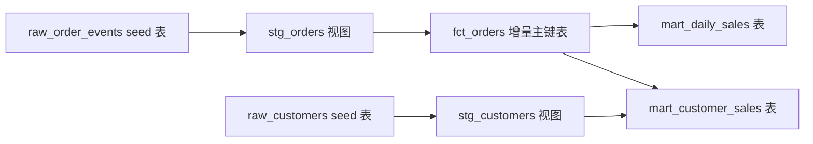

# 亲手体验 dbt 如何维护表、视图和血缘

这是逐步实验手册。每次只执行一个步骤，停下来查看数据库与 SQL，再执行下一步。脚本不会自动串起全部流程。

**当前起点：**助手在前一轮已经安装本目录 `.venv`，并在本地 StarRocks 的 `dbt_learning_demo` 库中生成了 2 张 seed 表、2 个视图和 3 张模型表，保留的是第二批结果（6 笔订单、495 元）。本轮仅改写文件，没有再次执行 dbt 或改动数据库。要观察从无到有的过程，先由你执行第 0 步的可选重置。

## 文件与操作约定

| 文件 | 用途 |
| --- | --- |
| `lab.ps1` | 每次执行一个指定步骤，先打印实际 dbt 命令；加 `-Preview` 只打印 |
| `observe.sql` | 在 SQL 客户端分段执行的观察查询 |
| `reset_demo.sql` | 可选的手动清理，仅删除本教程的 7 个对象 |
| `dbt_project.yml` | 模型目录、物化方式、seed 字段类型、演示批次 |
| `profiles.yml` | 本地 StarRocks 连接模板，密码读取环境变量 |
| `models/`、`seeds/`、`tests/` | 你维护的 SQL、模拟数据和数据质量规则 |

PowerShell 命令在本目录执行；SQL 在连接本地 StarRocks 的客户端执行，例如 IDE 数据库控制台。库名固定为 `dbt_learning_demo`，连接 FE MySQL 端口 `9030`。

```powershell
cd E:\IdeaProjects\agent-root\data-agent-v2\examples\dbt-starrocks
$dbt = '.\.venv\Scripts\dbt.exe'

# 只看用法或完整命令，不执行数据库操作。
.\lab.ps1
.\lab.ps1 -Step seed -Preview
```

本机已有虚拟环境，可以跳过安装。换机器或环境缺失时，再自行执行：

```powershell
python -m venv .venv
.\.venv\Scripts\python.exe -m pip install -r requirements.txt
```

依赖固定为 dbt-core 1.12.5、dbt-starrocks 1.12.2；上一轮使用 Python 3.14、StarRocks 3.5.19。默认连接 `127.0.0.1:9030`，root、空密码。有密码时在当前终端设置 `DBT_ENV_SECRET_STARROCKS_PASSWORD`，不要写进文件。主机、端口、账号可用 `DBT_STARROCKS_HOST`、`DBT_STARROCKS_PORT`、`DBT_STARROCKS_USER` 覆盖。

## 0. 选择是否从空白对象开始

先执行 `observe.sql` 的 **A 段**，查看前一轮留下的对象。如果需要从头体验，在 SQL 客户端打开并手动执行 `reset_demo.sql`。它会删除本教程的 7 个对象及其数据，不删除数据库或其他对象。

再次执行 A 段，应该看不到这些对象。不要用 `dbt clean` 代替数据库清理：它清理配置指定的本地生成目录，不删除 StarRocks 中的表。

```powershell
.\lab.ps1 -Step debug
```

**观察：**连接检查成功不会创建模型表。环境检查与模型执行是两件事。

## 1. 表还没建，dbt 已经知道依赖关系

打开 `models/marts/mart_customer_sales.sql`，找出两处 `ref()`。再逐层打开被引用的模型，追溯到 CSV。

```powershell
.\lab.ps1 -Step lineage
```

这一步执行 `dbt ls --select +mart_customer_sales --resource-type model seed`。前缀 `+` 选择祖先依赖，列表应包含两个 seed、两个 staging、事实表和客户汇总表；日汇总表不在客户汇总的上游。

**观察：**只列出节点，不创建表。dbt 根据项目中的 `ref()` 建立模型级血缘，不需要等表建好再靠数据库外键推测依赖。



`ref()` 同时负责对象引用和依赖声明。外部工具已经加载的表通常使用 `source()` 声明；本例数据由 seed 管理，所以使用 `ref()`。直接在 SQL 中写死库表名，不会自动形成对应的 dbt 模型依赖边。

## 2. seed：第一次看到真实表出现

```powershell
.\lab.ps1 -Step seed
```

执行 `observe.sql` 的 **A、B 段**。

**预期：**只有 `raw_customers`、`raw_order_events` 两张表。客户 3 行，订单事件 7 行；1003 有两个版本。seed 把 CSV 数据写进引擎，后续 SQL 的计算由 StarRocks 执行。

打开 `dbt_project.yml`，观察 seed 的 `column_types`，尤其是金额的 `decimal(18,2)`。seed 提供可复现的小数据，不承担生产环境的 CDC 或大规模数据同步。

## 3. staging：同样写 SELECT，却得到视图

```powershell
.\lab.ps1 -Step staging
```

执行 **A、C 段**，特别看 `SHOW CREATE VIEW`。

**预期：**新增两个 VIEW，`stg_orders` 返回第一批的 5 笔最新订单。原始表依然有 7 条事件，1003 在视图中还是 `pending / 50`。

打开 `stg_orders.sql`，它只有 CTE 和 SELECT，没有手写 `CREATE VIEW`。打开 `dbt_project.yml`，找到 `staging: +materialized: view`：**模型定义查询逻辑，物化配置和适配器决定如何维护数据库对象。**

视图定义中能看到 `batch_id <= 1`：Jinja 的批次变量已经变成 SQL 常量。它不会因为下次运行另一个模型时传入了新变量就自行改变。

## 4. fact：第一次创建增量表

```powershell
.\lab.ps1 -Step fact
```

执行 **D 段**。

**预期：**真实表 `fct_orders` 出现，5 笔订单，已支付金额 400 元。DDL 中可见 `PRIMARY KEY(order_id)`；它不是视图。

打开 `fct_orders.sql` 的 `config()`：`materialized='incremental'` 控制 dbt 的执行方式，`table_type='PRIMARY'` 与 `keys` 控制 StarRocks 的物理主键表。只声明 `unique_key` 不能代替物理主键配置。

第一次目标表不存在时，`is_incremental()` 为假，读取全部可见订单。以后目标表存在且未指定 `--full-refresh` 时，才应用更新时间过滤。

## 5. marts：汇总表保存本次计算的结果

```powershell
.\lab.ps1 -Step marts
```

执行 **A、E 段**。

**预期：**共 7 个对象，其中 2 个视图、5 张表。每日已支付额为 9 月 1 日 200 元、9 月 2 日 200 元；客户收入为 Alice 120、Bob 280、Carol 0。

汇总模型默认 `materialized: table`。后续重新运行时，由当前适配器重建表并重新计算；它不是 StarRocks 的自动刷新物化视图。单纯上游数据发生变化，不会触发 dbt 在后台运行。

## 6. 对照模型 SQL、编译 SQL 和执行 SQL

```powershell
.\lab.ps1 -Step compile
```

依次打开：

1. `models/marts/fct_orders.sql`：你维护的 Jinja + SQL。
2. `target/compiled/starrocks_learning/models/marts/fct_orders.sql`：`ref()`、`this` 和条件分支展开后的 SQL。
3. `target/run/starrocks_learning/models/marts/fct_orders.sql`：前面实际 run 产生的执行 SQL；更多 DDL 和元数据查询见 `logs/dbt.log`。

**观察：**此时目标表已存在，所以 compile 中会出现增量过滤，而前面首次 run 可能是建表 SQL。编译结果取决于变量与当前目标状态；`compile` 不会应用模型变更，但可以连接引擎读取元数据，不等于完全离线。

## 7. 数据测试：检查，不会替你修复数据

```powershell
.\lab.ps1 -Step test
```

打开 `models/schema.yml` 和 `tests/assert_demo_totals.sql`。这些查询检查唯一性、非空、状态枚举、客户关联以及学习数据的固定总量。正常首批预期通过 26 项测试。

下面刻意使用第二批预期检查首批数据，应报告失败，但不会把订单改成第二批：

```powershell
& $dbt test --profiles-dir . --select assert_demo_totals --vars 'demo_batch: 2'
```

执行 **D 段**确认表还是 5 笔、400 元。再执行 `lab.ps1 -Step test` 可用正确批次检查。`test` 验证现存数据；`run` 构建模型；`build` 可以按依赖顺序组合 seed、模型和测试。本教程先拆开，以观察每种命令的职责。

## 8. 核心实验：分三次推进，对比上游与下游

先执行 **F 段**，三个层次都应为 5 笔、400 元。每执行以下一条命令，就回 SQL 客户端重跑 F 段，不要一次粘贴整个流程。

**第一步：只改变视图定义。**

```powershell
.\lab.ps1 -Step batch2-view
```

视图现在能看到第二批：1003 更新为 `paid / 55`，新增 1006 `paid / 40`。C 段的视图定义应变为 `batch_id <= 2`。

**第二步：只更新事实表。**

```powershell
.\lab.ps1 -Step batch2-fact
```

事实表新增一单、覆盖旧单，汇总表仍保持旧结果。打开刚生成的 `target/run` SQL 和日志观察 INSERT；同主键的覆盖由 StarRocks PRIMARY KEY 表完成。

**第三步：重新计算汇总表。**

```powershell
.\lab.ps1 -Step batch2-marts
```

| 时点 | stg_orders | fct_orders | mart_daily_sales 合计 |
| --- | --- | --- | --- |
| 第一批完成 | 5 笔 / 400 元 | 5 笔 / 400 元 | 5 笔 / 400 元 |
| 只切换视图 | 6 笔 / 495 元 | 5 笔 / 400 元 | 5 笔 / 400 元 |
| 再更新事实表 | 6 笔 / 495 元 | 6 笔 / 495 元 | 5 笔 / 400 元 |
| 再运行汇总表 | 6 笔 / 495 元 | 6 笔 / 495 元 | 6 笔 / 495 元 |

再次手动执行 `batch2-fact`，查询 D 段，应该仍为 6 笔、495 元。这是主键覆盖带来的幂等。

1006 的更新时间被刻意设置为首批最大更新时间，演示 `>=` 边界；写成 `>` 会漏单。这一简单算法不处理早于水位的迟到变更或源端物理删除。切回批次 1 也不会撤销已写入的第二批，需要全量重建。

```powershell
.\lab.ps1 -Step test -Batch 2
```

现在可以理解 `dbt run --select 'fct_orders+'`：按依赖顺序运行事实表和下游。血缘决定选择范围与顺序，**并不意味着下游被持续自动刷新**。前缀 `+` 选上游，后缀 `+` 选下游；选择单个模型不会默认补齐全部上游。

## 9. 在浏览器看血缘，再直接看 manifest

```powershell
.\lab.ps1 -Step docs -Batch 2
.\lab.ps1 -Step serve
```

浏览器打开 [本地 dbt 文档](http://localhost:8088)。文档服务占用当前终端，按 Ctrl+C 关闭。

选择 `mart_customer_sales`，查看 SQL、字段、测试和依赖图，沿上游走回两份 seed。再选 `mart_daily_sales`，它不依赖客户维度视图。这里展示模型级关系，不是逐字段血缘。

在另一个 PowerShell 终端进入本目录，直接读取生成文件：

```powershell
$manifest = Get-Content .\target\manifest.json -Raw | ConvertFrom-Json
$manifest.nodes.'model.starrocks_learning.mart_customer_sales'.depends_on.nodes
```

预期直接依赖为 `stg_customers`、`fct_orders`（顺序不重要）。`manifest.json` 记录项目节点、配置和依赖；`catalog.json` 记录引擎实际对象的元数据。文档是生成时的快照，改模型后需要重新生成，正在浏览的页面也需要刷新。

## 10. 自己改一次模型，观察表结构维护

完成基线实验后，打开 `models/marts/mart_daily_sales.sql`，在 SELECT 中 `sum(paid_amount) as paid_amount` 后面加逗号和一列：

```sql
    avg(amount) as avg_order_amount
```

它表示所有订单（包括待支付、取消订单）的平均金额。先只保存文件，再执行 E 段：**数据库表还没有这列。**

```powershell
& $dbt run --profiles-dir . --select mart_daily_sales --vars 'demo_batch: 2'
```

再次执行 E 段，查看 DDL 和结果中的新列。然后在 `models/schema.yml` 为该字段补充中文描述，重新执行 `docs -Batch 2`，查看文档更新。新增一列但 `ref()` 没变，所以模型依赖边不变。

该实验针对 `table` 物化。增量模型增删改字段需要另行考虑 `on_schema_change` 和历史数据回填，不能把这里的重建行为套到所有模型上。

完成后自行移除新增列和字段描述，再运行该模型即可恢复。如果重命名模型 SQL 文件，dbt 通常按新名字构建新对象，不会自动迁移或清理旧表；模型代码维护与历史对象清理需要分别处理。

## 需要重来时

由你选择一种方式：

- 重新观察对象从无到有：手动执行 `reset_demo.sql`，再从 seed 分步运行。
- 只恢复第一批完整数据：执行下面的全量构建，一次重建本项目 seed 和模型；不作为第一次体验入口。

```powershell
& $dbt build --profiles-dir . --full-refresh --vars 'demo_batch: 1'
```

`target/`、`logs/`、`.venv/` 已忽略，无需提交。你维护模型 SQL、配置、测试和文档描述，dbt 负责将这些定义编译并交给 StarRocks 执行。

官方参考：[StarRocks 适配器](https://github.com/StarRocks/dbt-starrocks)、[连接配置](https://docs.getdbt.com/docs/local/connect-data-platform/starrocks-setup)。
