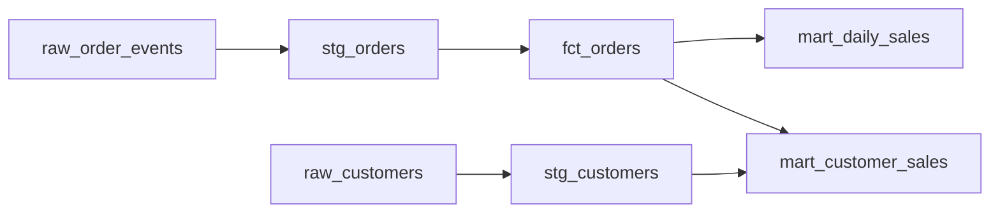

# dbt + StarRocks 手动实验指南

本文包含每一步需要的终端命令、观察 SQL、预期结果和原理说明。直接复制对应代码块执行，不依赖任何 PowerShell 脚本文件，也不需要先打开其他 SQL 文件。

**操作原则：每次完成一小步，观察结果，再继续。** `powershell` 代码块在终端执行；`sql` 代码块在连接 StarRocks 的数据库控制台执行；标注为“修改文件”的内容写入对应文件，不直接提交给数据库。

之前助手已安装本目录的虚拟环境，并生成过 demo 对象，最后保留的是第二批结果（6 笔订单、495 元）。本次仅整理文档，没有运行下面任何实验指令。数据库当前状态以你在第 1 步查询到的结果为准。

## 0. 准备终端和数据库控制台

### 0.1 进入项目目录

打开 PowerShell，执行：

```powershell
cd E:\IdeaProjects\agent-root\data-agent-v2\examples\dbt-starrocks
```

后续所有终端命令都在这个目录执行。使用虚拟环境中的可执行文件完整相对路径，无需激活环境或设置命令别名。

### 0.2 检查 Python 和 dbt

```powershell
python --version
Test-Path .\.venv\Scripts\dbt.exe
```

如果第二条返回 `True`，跳过安装，直接查看 dbt 版本：

```powershell
.\.venv\Scripts\dbt.exe --version
```

**仅当虚拟环境不存在时**执行安装：

```powershell
python -m venv .venv
.\.venv\Scripts\python.exe -m pip install -r requirements.txt
.\.venv\Scripts\dbt.exe --version
```

项目固定使用 `dbt-core==1.12.5`、`dbt-starrocks==1.12.2`；此前环境为 Python 3.14、StarRocks 3.5.19。

### 0.3 连接 StarRocks

在 IDE 或其他 SQL 客户端新建 MySQL 协议连接，参数如下：

| 参数 | 本地默认值 |
| --- | --- |
| 主机 | `127.0.0.1` |
| 端口 | `9030` |
| 用户 | `root` |
| 密码 | 空 |
| 数据库 | 初次连接可不选，下面 SQL 均显式写库名 |

`9030` 是数据库协议端口，`8030` 是 HTTP 端口，不能互换。若你已修改账号或密码，同时在运行 dbt 的终端设置对应环境变量；默认配置可跳过：

```powershell
$env:DBT_STARROCKS_HOST = '127.0.0.1'
$env:DBT_STARROCKS_PORT = '9030'
$env:DBT_STARROCKS_USER = 'root'
# 仅当实际配置了密码时填写，不要将真实密码写入仓库文件。
# $env:DBT_ENV_SECRET_STARROCKS_PASSWORD = '你的本地密码'
```

检查 dbt 连接：

```powershell
.\.venv\Scripts\dbt.exe debug --profiles-dir .
```

**观察：**连接成功不代表模型已创建。`debug` 检查配置和连接，本身不构建模型。

## 1. 查看已有对象，选择是否从空白开始

在 SQL 控制台执行：

```sql
SELECT TABLE_NAME, TABLE_TYPE
FROM information_schema.tables
WHERE TABLE_SCHEMA = 'dbt_learning_demo'
ORDER BY TABLE_NAME;
```

前一次执行可能留下 7 个对象。为了按下面的预期观察“表逐个出现”，可以手动执行以下重置。

**以下 SQL 会删除列出的 7 个 demo 对象及其数据；不会删除数据库和其他对象。确认其中没有你另行保存的数据后再执行。**

```sql
DROP TABLE IF EXISTS dbt_learning_demo.mart_customer_sales;
DROP TABLE IF EXISTS dbt_learning_demo.mart_daily_sales;
DROP TABLE IF EXISTS dbt_learning_demo.fct_orders;
DROP VIEW IF EXISTS dbt_learning_demo.stg_orders;
DROP VIEW IF EXISTS dbt_learning_demo.stg_customers;
DROP TABLE IF EXISTS dbt_learning_demo.raw_order_events;
DROP TABLE IF EXISTS dbt_learning_demo.raw_customers;
```

重新执行本节第一条查询，确认这些对象不再出现。下文按已完成重置或首次执行的情况描述。

`dbt clean` 只清理配置指定的本地生成目录，不会删除数据库对象，因此不能代替这里的重置。

## 2. 尚未建表，先查看 dbt 的血缘

在终端执行：

```powershell
.\.venv\Scripts\dbt.exe ls --profiles-dir . --select '+mart_customer_sales' --resource-type model seed --vars 'demo_batch: 1'
```

**预期列出 6 个节点，顺序不重要：**

- `raw_customers`
- `raw_order_events`
- `stg_customers`
- `stg_orders`
- `fct_orders`
- `mart_customer_sales`

`mart_daily_sales` 不在客户汇总的上游，所以不在这个列表里。再执行第 1 节的对象查询，数据库应仍无这些对象。

打开 `models/marts/mart_customer_sales.sql`，看到类似：

```jinja
from {{ ref('stg_customers') }} c
left join {{ ref('fct_orders') }} o on c.customer_id = o.customer_id
```

这是模型文件的片段，不能直接粘到 SQL 控制台。`ref()` 既解析实际库表名，又声明节点依赖，dbt 在建表之前就能建立下面的模型级血缘：



`+模型` 选择上游，`模型+` 选择下游。只选择单个模型不会自动运行所有祖先。直接写死数据库表名也不会自动形成对应的 dbt 依赖边。外部工具已加载的表通常使用 `source()` 声明；本例原始数据由 seed 管理，所以使用 `ref()`。

## 3. seed：将 CSV 写成两张真实表

在终端执行：

```powershell
.\.venv\Scripts\dbt.exe seed --profiles-dir .
```

随后在 SQL 控制台执行：

```sql
SELECT TABLE_NAME, TABLE_TYPE
FROM information_schema.tables
WHERE TABLE_SCHEMA = 'dbt_learning_demo'
ORDER BY TABLE_NAME;

SELECT * FROM dbt_learning_demo.raw_customers ORDER BY customer_id;
SELECT * FROM dbt_learning_demo.raw_order_events ORDER BY event_id;
```

**预期：**出现两张表，客户 3 行，订单事件 7 行。1003 有两个版本，第二个版本属于 `batch_id=2`。这时没有 staging 视图和销售汇总表。

打开 `dbt_project.yml`，观察 seed 的 `column_types`，尤其是金额 `decimal(18,2)`。CSV 数据在 `seeds/` 目录；dbt 将它们加载到 StarRocks，之后的 SQL 计算由 StarRocks 完成。seed 适合小数据和字典，不承担生产 CDC。

## 4. staging：用 SELECT 定义两个视图

在终端执行：

```powershell
.\.venv\Scripts\dbt.exe run --profiles-dir . --select stg_customers stg_orders --vars 'demo_batch: 1'
```

观察 SQL：

```sql
SELECT TABLE_NAME, TABLE_TYPE
FROM information_schema.tables
WHERE TABLE_SCHEMA = 'dbt_learning_demo'
ORDER BY TABLE_NAME;

SHOW CREATE VIEW dbt_learning_demo.stg_orders;
SELECT order_id, status, amount, updated_at
FROM dbt_learning_demo.stg_orders
ORDER BY order_id;
```

**预期：**现在共 4 个对象，两张原始表、两个视图。订单视图只有 5 行，1003 还是 `pending / 50.00`，原始表仍有 7 条事件。

查看 `models/staging/stg_orders.sql`：你只写了查询、批次过滤和取最新版本的窗口函数，没有手写 `CREATE VIEW`。实际维护视图由 `dbt_project.yml` 中的配置驱动：

```yaml
models:
  starrocks_learning:
    staging:
      +materialized: view
```

这里是现有配置片段，不需要覆盖文件。`SHOW CREATE VIEW` 中应能看到 `batch_id <= 1`：Jinja 变量在运行时编译为 SQL 常量。以后只给另一个模型传入第二批变量，不会自动修改这个已保存的视图定义。

## 5. fact：第一次创建增量主键表

在终端执行：

```powershell
.\.venv\Scripts\dbt.exe run --profiles-dir . --select fct_orders --vars 'demo_batch: 1'
```

观察 SQL：

```sql
SHOW CREATE TABLE dbt_learning_demo.fct_orders;

SELECT order_id, status, amount, paid_amount, updated_at
FROM dbt_learning_demo.fct_orders
ORDER BY order_id;

SELECT COUNT(*) AS order_count, SUM(paid_amount) AS paid_amount
FROM dbt_learning_demo.fct_orders;
```

**预期：**5 笔订单，已支付金额 `400.00`。待支付和取消订单仍保留，但 `paid_amount=0`。DDL 中能看到物理 `PRIMARY KEY(order_id)`。

打开 `models/marts/fct_orders.sql`，对照配置：

- `materialized='incremental'`：决定 dbt 使用增量模型维护流程。
- `table_type='PRIMARY'`、`keys=['order_id']`：决定 StarRocks 的物理主键表。
- `unique_key='order_id'`：不能代替上述物理主键配置。

首次目标表不存在时，`is_incremental()` 为假，读取全部可见数据。目标表已存在且未指定 `--full-refresh` 时，才启用模型里写的增量过滤。

## 6. marts：创建两张汇总表

在终端执行：

```powershell
.\.venv\Scripts\dbt.exe run --profiles-dir . --select mart_daily_sales mart_customer_sales --vars 'demo_batch: 1'
```

观察 SQL：

```sql
SELECT TABLE_NAME, TABLE_TYPE
FROM information_schema.tables
WHERE TABLE_SCHEMA = 'dbt_learning_demo'
ORDER BY TABLE_NAME;

SHOW CREATE TABLE dbt_learning_demo.mart_daily_sales;
SELECT * FROM dbt_learning_demo.mart_daily_sales ORDER BY order_date;
SELECT * FROM dbt_learning_demo.mart_customer_sales ORDER BY customer_id;
```

**预期：**共 7 个对象，5 张表、2 个视图。每日收入如下：

| order_date | order_count | paid_order_count | paid_amount |
| --- | --- | --- | --- |
| 2026-09-01 | 2 | 2 | 200.00 |
| 2026-09-02 | 3 | 1 | 200.00 |

客户收入为 Alice 120、Bob 280、Carol 0。客户汇总用 LEFT JOIN 保留没有已支付收入的客户。

汇总模型默认 `materialized: table`，保存本次查询的结果；当前适配器在重新运行时重建并重新计算。它不是自动刷新的 StarRocks 物化视图，上游发生变化不会触发 dbt 在后台运行。

## 7. 对照模型、编译 SQL 和执行 SQL

在终端执行：

```powershell
.\.venv\Scripts\dbt.exe compile --profiles-dir . --select fct_orders --vars 'demo_batch: 1'
```

继续在终端查看三个文件：

```powershell
Get-Content .\models\marts\fct_orders.sql -Encoding UTF8
Get-Content .\target\compiled\starrocks_learning\models\marts\fct_orders.sql -Encoding UTF8
Get-Content .\target\run\starrocks_learning\models\marts\fct_orders.sql -Encoding UTF8
```

依次观察：

1. 源模型含 `ref()`、`this`、`is_incremental()` 等模板语法。
2. 编译 SQL 已替换为实际对象名；由于目标表已存在，当前会包含增量过滤条件。
3. `target/run` 保留前面实际 run 生成的执行 SQL；第一次 run 是建表流程，可能与此时编译出的增量查询不同。更多执行语句可查看 `logs/dbt.log`。

`compile` 不应用模型变更，但可能连接数据库读取元数据，不等于完全离线。编辑 SQL 文件也不会立即改变数据库，必须运行模型才会生效。

## 8. 数据测试：观察成功和一次刻意失败

正常检查第一批：

```powershell
.\.venv\Scripts\dbt.exe test --profiles-dir . --vars 'demo_batch: 1'
```

预期 26 项测试通过。规则在 `models/schema.yml` 和 `tests/`：包含非空、唯一性、状态枚举、关联关系和收入口径检查。

刻意拿第二批的“6 笔 / 495 元”预期检查当前第一批数据：

```powershell
.\.venv\Scripts\dbt.exe test --profiles-dir . --select assert_demo_totals --vars 'demo_batch: 2'
```

**预期此条失败。**然后查询，确认测试没有替你修改表：

```sql
SELECT COUNT(*) AS order_count, SUM(paid_amount) AS paid_amount
FROM dbt_learning_demo.fct_orders;
```

结果仍为 5 笔、400 元。恢复正确预期：

```powershell
.\.venv\Scripts\dbt.exe test --profiles-dir . --select assert_demo_totals --vars 'demo_batch: 1'
```

这条应通过。数据测试用查询识别问题，不会代替数据修复或数据库约束。固定总量测试仅适用于本教程的模拟数据。

## 9. 核心实验：分三次推进第二批

本节每执行一次 dbt 命令，都要查询数据库。不要连续执行完三个阶段才看结果。

### 9.1 先记录三层初始结果

在 SQL 控制台保存并执行这段查询。后续每一步都重新执行它：

```sql
SELECT 'stg_orders' AS layer, COUNT(*) AS order_count,
       SUM(CASE WHEN status = 'paid' THEN amount ELSE 0 END) AS paid_amount
FROM dbt_learning_demo.stg_orders
UNION ALL
SELECT 'fct_orders', COUNT(*), SUM(paid_amount)
FROM dbt_learning_demo.fct_orders
UNION ALL
SELECT 'mart_daily_sales', SUM(order_count), SUM(paid_amount)
FROM dbt_learning_demo.mart_daily_sales;
```

**预期：**三层都是 5 笔、400 元。

### 9.2 只切换视图到第二批

终端执行：

```powershell
.\.venv\Scripts\dbt.exe run --profiles-dir . --select stg_orders --vars 'demo_batch: 2'
```

SQL 控制台执行：

```sql
SHOW CREATE VIEW dbt_learning_demo.stg_orders;
SELECT order_id, status, amount, updated_at
FROM dbt_learning_demo.stg_orders ORDER BY order_id;
```

然后重新执行 **9.1 的三层对比 SQL**。

**预期：**视图定义变成 `batch_id <= 2`，视图为 6 笔、495 元；事实表和汇总表仍为 5 笔、400 元。1003 已变为 `paid / 55`，1006 新增为 `paid / 40`，但暂时只在视图中可见。

### 9.3 只更新事实表

终端执行：

```powershell
.\.venv\Scripts\dbt.exe run --profiles-dir . --select fct_orders --vars 'demo_batch: 2'
```

SQL 控制台执行：

```sql
SELECT order_id, status, amount, paid_amount, updated_at
FROM dbt_learning_demo.fct_orders
WHERE order_id IN (1003, 1006)
ORDER BY order_id;
```

重新执行 **9.1 的三层对比 SQL**。

**预期：**视图和事实表为 6 笔、495 元，汇总表还停在 5 笔、400 元。

终端查看实际 SQL，注意增量过滤与 INSERT：

```powershell
Get-Content .\target\run\starrocks_learning\models\marts\fct_orders.sql -Encoding UTF8
```

相同订单被覆盖依赖 StarRocks PRIMARY KEY 表的写入语义。模型里的 `>=` 会包含水位边界：1006 的更新时间刻意等于首批最大更新时间，使用 `>` 就会漏掉它。

### 9.4 最后重算汇总表

终端执行：

```powershell
.\.venv\Scripts\dbt.exe run --profiles-dir . --select mart_daily_sales mart_customer_sales --vars 'demo_batch: 2'
```

重新执行 **9.1 的三层对比 SQL**，三层现在都为 6 笔、495 元。

```sql
SELECT * FROM dbt_learning_demo.mart_daily_sales ORDER BY order_date;
SELECT * FROM dbt_learning_demo.mart_customer_sales ORDER BY customer_id;
```

每日已支付额应为 200、255、40；客户已支付额应为 Alice 175、Bob 280、Carol 40。1003 的变更回算到了原订单日期 9 月 2 日。

| 时点 | stg_orders | fct_orders | mart_daily_sales 合计 |
| --- | --- | --- | --- |
| 第一批完成 | 5 / 400 | 5 / 400 | 5 / 400 |
| 只切换视图 | 6 / 495 | 5 / 400 | 5 / 400 |
| 再更新事实表 | 6 / 495 | 6 / 495 | 5 / 400 |
| 再重算汇总 | 6 / 495 | 6 / 495 | 6 / 495 |

**你刚观察到：血缘决定依赖和执行顺序，但不会持续自动刷新下游。**

### 9.5 重复增量，观察幂等

再次执行同一个事实模型：

```powershell
.\.venv\Scripts\dbt.exe run --profiles-dir . --select fct_orders --vars 'demo_batch: 2'
```

观察 SQL：

```sql
SELECT COUNT(*) AS order_count, SUM(paid_amount) AS paid_amount
FROM dbt_learning_demo.fct_orders;

SELECT order_id, COUNT(*) AS row_count
FROM dbt_learning_demo.fct_orders
GROUP BY order_id
HAVING COUNT(*) > 1;
```

预期仍是 6 笔、495 元，重复主键查询返回 0 行。最后检查所有测试：

```powershell
.\.venv\Scripts\dbt.exe test --profiles-dir . --vars 'demo_batch: 2'
```

这一简单水位算法不处理早于水位的迟到更新或源端物理删除。只把变量改回 1 也不会撤销已写入的第二批，需要全量重建。

## 10. 亲手使用血缘选择器

先只查看选择范围，不运行模型：

```powershell
.\.venv\Scripts\dbt.exe ls --profiles-dir . --select 'fct_orders+' --resource-type model --vars 'demo_batch: 2'
.\.venv\Scripts\dbt.exe ls --profiles-dir . --select '+fct_orders' --resource-type model seed --vars 'demo_batch: 2'
```

第一条列出事实表和两张下游汇总表；第二条列出事实表、订单视图及订单 seed。

再执行：

```powershell
.\.venv\Scripts\dbt.exe run --profiles-dir . --select 'fct_orders+' --vars 'demo_batch: 2'
```

观察控制台执行顺序：事实表完成后，下游汇总才能运行。这里你主动用 `+` 指定了下游，dbt 才一起运行；没有 `+` 时只运行被选中的模型。

`run` 只构建模型，不导入 seed，也不运行数据测试；`build` 可以按依赖组合 seed、模型和测试。第一次体验先分开操作，更容易看清职责。

## 11. 生成文档，在页面和 manifest 中查看血缘

先生成文档：

```powershell
.\.venv\Scripts\dbt.exe docs generate --profiles-dir . --vars 'demo_batch: 2'
```

再启动文档服务：

```powershell
.\.venv\Scripts\dbt.exe docs serve --profiles-dir . --port 8088
```

浏览器打开 [本地 dbt 文档](http://localhost:8088)。这条命令占用当前终端，按 Ctrl+C 停止服务。

在页面中：

1. 找到 `mart_customer_sales`，查看 SQL、字段和测试。
2. 打开依赖图，沿 `stg_customers`、`fct_orders` 追溯到两个 seed。
3. 再看 `mart_daily_sales`，它不依赖客户维度视图。

这是模型级血缘，不是逐字段血缘。

新开一个 PowerShell 终端，直接读取 manifest：

```powershell
cd E:\IdeaProjects\agent-root\data-agent-v2\examples\dbt-starrocks
$manifest = Get-Content .\target\manifest.json -Raw -Encoding UTF8 | ConvertFrom-Json
$manifest.nodes.'model.starrocks_learning.mart_customer_sales'.depends_on.nodes
```

预期直接依赖为：

```text
model.starrocks_learning.stg_customers
model.starrocks_learning.fct_orders
```

顺序不重要。`manifest.json` 记录项目节点、配置和依赖，`catalog.json` 记录真实引擎对象的元数据。文档是生成时的快照，修改模型后需要重新生成并刷新页面。

## 12. 改一次模型，观察数据库表结构何时变化

### 12.1 修改文件，先不要运行 dbt

在编辑器中打开 `models/marts/mart_daily_sales.sql`，将内容改为下面完整模型。**这是模型文件内容，不是在 SQL 控制台执行的语句。**

```jinja
{{ config(distributed_by=['order_date']) }}

-- 聚合表每次全量重建，使旧订单变化回算到原订单日期。
-- 平均金额包含全部状态的订单，不等同于已支付订单平均金额。
select
    order_date,
    count(*) as order_count,
    sum(case when status = 'paid' then 1 else 0 end) as paid_order_count,
    sum(paid_amount) as paid_amount,
    avg(amount) as avg_order_amount
from {{ ref('fct_orders') }}
group by order_date
```

保存后，在 SQL 控制台执行：

```sql
SHOW CREATE TABLE dbt_learning_demo.mart_daily_sales;
SELECT * FROM dbt_learning_demo.mart_daily_sales ORDER BY order_date;
```

**预期：**数据库中还没有 `avg_order_amount`。保存本地 SQL 文件不等于执行数据库变更。

### 12.2 运行模型，再观察新列

终端执行：

```powershell
.\.venv\Scripts\dbt.exe run --profiles-dir . --select mart_daily_sales --vars 'demo_batch: 2'
```

再次执行上述两条观察 SQL，新列应出现。这是 `table` 物化重建后的结构和数据；不是后台自动同步文件变更。

### 12.3 添加字段说明，更新文档

编辑 `models/schema.yml`，在现有 `name: mart_daily_sales` 的 `columns` 列表末尾添加下面一项，保持与同级字段相同缩进。不要覆盖整个 YAML 文件：

```yaml
      - name: avg_order_amount
        description: 全部订单的平均金额，包含待支付和取消订单，单位为元。
```

终端重新生成文档：

```powershell
.\.venv\Scripts\dbt.exe docs generate --profiles-dir . --vars 'demo_batch: 2'
```

若文档服务仍在运行，刷新页面；如果已关闭，重新执行：

```powershell
.\.venv\Scripts\dbt.exe docs serve --profiles-dir . --port 8088
```

**观察：**新列和说明出现，但 `ref()` 没变，模型之间的依赖边不变。字段描述来自你维护的 YAML，文档中的真实列信息来自引擎元数据。

### 12.4 恢复实验前的模型

自行移除模型中的 `avg(amount) as avg_order_amount`，同时去掉上一列末尾多出的逗号；从 YAML 移除刚新增的字段说明。然后执行：

```powershell
.\.venv\Scripts\dbt.exe run --profiles-dir . --select mart_daily_sales --vars 'demo_batch: 2'
.\.venv\Scripts\dbt.exe docs generate --profiles-dir . --vars 'demo_batch: 2'
```

再次查询 DDL，新列应消失。

本实验针对 `table` 物化。增量模型增删改字段需要另外考虑 `on_schema_change` 和历史数据回填，不能套用相同重建预期。重命名 SQL 模型文件也不等于数据库表迁移，旧表通常需要另行清理。

## 13. 需要重来时

若想重新观察从无到有，手动执行第 1 节的清理 SQL，再从 seed 开始逐步操作。

若只想一次恢复第一批全部数据，在完成上述模型代码恢复后执行：

```powershell
.\.venv\Scripts\dbt.exe build --profiles-dir . --full-refresh --vars 'demo_batch: 1'
```

这会重建当前 demo 的 seed 和模型，并执行测试，不保留刚才第二批的表数据。完成后可再次查询：

```sql
SELECT COUNT(*) AS order_count, SUM(paid_amount) AS paid_amount
FROM dbt_learning_demo.fct_orders;
```

预期回到 5 笔、400 元。如果继续生成文档，也将批次同步改回 1：

```powershell
.\.venv\Scripts\dbt.exe docs generate --profiles-dir . --vars 'demo_batch: 1'
```

## 命令与职责对照

| 命令 | 你会观察到什么 |
| --- | --- |
| `debug` | 配置、依赖和数据库连接检查 |
| `ls` | 从代码解析出的节点与依赖选择结果，不创建模型 |
| `seed` | CSV 被加载成数据库表 |
| `compile` | 模板展开成 SQL，不应用模型变更，可能读取引擎元数据 |
| `run` | 按所选模型的物化方式创建或维护表、视图 |
| `test` | 查询现存数据，报告通过或失败 |
| `build` | 按依赖组合 seed、模型和测试等资源 |
| `docs generate` | 生成项目文档、manifest 和引擎 catalog |
| `docs serve` | 启动本地文档网站，不执行数据构建 |
| `clean` | 清理配置指定的本地生成目录，不清理数据库表 |

你维护的是 `models/`、`seeds/`、`tests/` 和 YAML 配置。`target/`、`logs/`、`.venv/` 是本地生成内容，已忽略，无需提交。

官方参考：[StarRocks 适配器](https://github.com/StarRocks/dbt-starrocks)、[dbt 连接配置](https://docs.getdbt.com/docs/local/connect-data-platform/starrocks-setup)。
